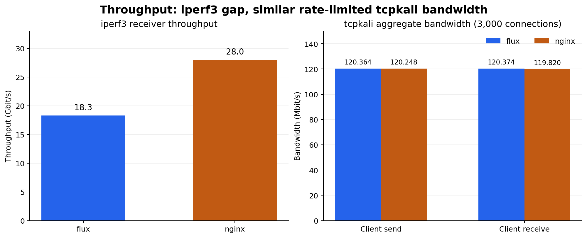
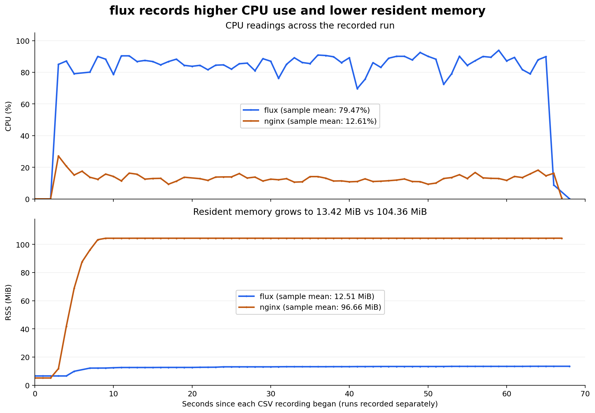

# 벤치마크 측정

[132ec17](https://github.com/juny0955/flux/commit/132ec17a4d2066dd1475e5ebfe8bc3c6f0ef9091) 커밋 기준으로 기록된 iperf3·tcpkali 결과와, 2026-10-26에 **tcpkali 테스트 중 수집한** [flux.csv](../flux.csv)·[nginx.csv](../nginx.csv)의 CPU·메모리 측정값을 함께 분석한다.

## 주요 결과

| 구분                                 |           flux |          nginx | 해석                                                |
| ------------------------------------ | -------------: | -------------: | --------------------------------------------------- |
| iperf3 수신 처리량                   |    18.3 Gbit/s |    28.0 Gbit/s | flux는 nginx의 65.4%                                |
| tcpkali 클라이언트 수신 대역폭       | 120.374 Mbit/s | 119.820 Mbit/s | flux가 0.46% 높음; 해당 제한 부하에서는 유사한 수준 |
| tcpkali 자원 기록 전체 표본 평균 CPU |         79.47% |         12.61% | 기록된 CPU 사용률은 flux가 약 6.30배                |
| tcpkali 자원 기록 최대 RSS           |      13.42 MiB |     104.36 MiB | 기록된 최대 RSS는 flux가 약 87.1% 낮음              |

iperf3에서는 nginx의 처리량이 높다. tcpkali에서는 두 구현이 3,000개 연결에 도달했고 전송·수신 대역폭이 비슷한 가운데, flux의 CPU 사용률이 높고 RSS가 낮았다. 즉, 이번 tcpkali 부하에서 flux는 유사한 대역폭을 더 높은 CPU 사용률과 더 적은 상주 메모리로 처리했다. 자원 통계는 시작·종료 부근을 포함한 기록 전체 기준이며, iperf3 실행 중의 자원 사용량을 나타내지는 않는다.

## 측정 조건

로컬 루프백(`127.0.0.1`) 환경에서 비교했다. nginx는 flux와 워커 수를 맞춰 단일 워커 프로세스로 설정했다. nginx의 프록시 포트는 `9001`, flux의 프록시 포트는 `9000`이다.

```shell
worker_processes  1;
worker_rlimit_nofile 16384;

events {
    worker_connections 8192;
}

stream {
    server {
        listen 127.0.0.1:9001;
        proxy_pass 127.0.0.1:8080;

        proxy_connect_timeout 5s;
        proxy_timeout 60s;
    }
}
```

## 처리량 비교 시각화



iperf3와 tcpkali는 부하 조건과 단위가 다르므로 별도 축으로 표시했다. tcpkali의 송신·수신 방향은 클라이언트 기준이다.

## iperf3: 대용량 전송 처리량

10개의 병렬 스트림으로 30초간 측정하며, 초기 3초는 통계에서 제외한다. 아래 명령은 flux 기준이며 nginx는 포트를 `9001`로 바꿔 실행한다.

```shell
iperf3 -c 127.0.0.1 -p 9000 -P 10 -t 30 -O 3
```

### flux

```text
[SUM] 0.00-30.00 sec 64.0 GBytes 18.3 Gbits/sec 0 sender
[SUM] 0.00-30.00 sec 64.0 GBytes 18.3 Gbits/sec receiver
```

### nginx

```text
[SUM] 0.00-30.00 sec 97.7 GBytes 28.0 Gbits/sec 0 sender
[SUM] 0.00-30.01 sec 97.7 GBytes 28.0 Gbits/sec receiver
```

### 비교

| 항목        |      flux |     nginx | nginx 대비 flux |
| ----------- | --------: | --------: | --------------: |
| 송신 처리량 | 18.3 Gbps | 28.0 Gbps |           65.4% |
| 수신 처리량 | 18.3 Gbps | 28.0 Gbps |           65.4% |

flux의 처리량은 nginx의 약 65.4%로, nginx보다 약 34.6% 낮다. 반대로 nginx는 flux의 약 1.53배 처리량을 기록했다. 양쪽 모두 출력에 표시된 재전송 횟수는 0이다.

이 결과는 로컬 루프백에서 10개 스트림을 처리하는 조건의 차이다. 실제 네트워크, 다른 연결 수 또는 메시지 크기에서도 동일한 비율이 유지된다고 일반화할 수는 없다.

## tcpkali: 다중 연결·제한 전송률 부하

최대 3,000개 연결, 초당 1,000개 연결 생성, 연결당 초당 1,000개 메시지 전송 설정으로 60초간 실행했다. 아래 명령은 flux 기준이며 nginx는 포트를 `9001`로 바꿔 실행한다.

```shell
tcpkali -c 3000 --connect-rate 1000 -T 60s -m "hello" -r 1000 127.0.0.1:9000
```

### flux

```text
Destination: [127.0.0.1]:9000
Interface lo0 address [127.0.0.1]:0
Using interface lo0 to connect to [127.0.0.1]:9000
Ramped up to 3000 connections.
Total data sent: 860.9 MiB (902747475 bytes)
Total data received: 861.0 MiB (902823355 bytes)
Bandwidth per channel: 0.080⇅ Mbps (10.0 kBps)
Aggregate bandwidth: 120.374↓, 120.364↑ Mbps
Packet rate estimate: 37102.5↓, 132464.7↑ (1↓, 1↑ TCP MSS/op)
Test duration: 60.0012 s.
```

### nginx

```text
Destination: [127.0.0.1]:9001
Interface lo0 address [127.0.0.1]:0
Using interface lo0 to connect to [127.0.0.1]:9001
Ramped up to 3000 connections.
Total data sent:     860.1 MiB (901861550 bytes)
Total data received: 857.0 MiB (898648508 bytes)
Bandwidth per channel: 0.080⇅ Mbps (10.0 kBps)
Aggregate bandwidth: 119.820↓, 120.248↑ Mbps
Packet rate estimate: 10752.6↓, 127817.1↑ (3↓, 1↑ TCP MSS/op)
Test duration: 60 s.
```

### 비교 및 분석

| 항목         |              flux |             nginx | nginx 대비 flux |
| ------------ | ----------------: | ----------------: | --------------: |
| 도달 연결 수 |             3,000 |             3,000 |            동일 |
| 총 송신량    | 902,747,475 bytes | 901,861,550 bytes |               — |
| 총 수신량    | 902,823,355 bytes | 898,648,508 bytes |               — |
| 송신 대역폭  |    120.364 Mbit/s |    120.248 Mbit/s |          +0.10% |
| 수신 대역폭  |    120.374 Mbit/s |    119.820 Mbit/s |          +0.46% |
| 실행 시간    |         60.0012 s |              60 s |         약 60초 |

두 구현 모두 설정한 연결 수에 도달했고, 대역폭은 송신 약 120 Mbit/s·수신 약 120 Mbit/s로 유사하다. 다만 `-r 1000`으로 메시지 전송률이 제한되어 있으므로, 이 결과만으로 두 구현의 최대 처리량이 같다고 결론낼 수 없다. 0.10~0.46%의 차이도 반복 측정 없이 성능 우위로 단정하기 어렵다.

이 테스트 중 수집한 CSV를 함께 보면, flux는 유사한 대역폭을 유지하면서 평균 CPU 사용률이 nginx의 약 6.30배였고, 최대 RSS는 nginx보다 약 87.1% 낮았다. 이번 부하에서는 nginx의 CPU 사용률이 더 낮고 flux의 상주 메모리가 더 적다는 차이가 드러난다. 상세 집계와 시간에 따른 변화는 아래에 정리했다.

nginx의 총 수신량은 총 송신량보다 3,213,042 bytes(송신량의 약 0.36%) 적고, flux는 총 수신량이 75,880 bytes 많다. 실행 종료 시점의 미수신 데이터나 집계 경계 등을 확인해야 하며, 이 요약 출력만으로 데이터 유실 또는 중복 전송을 판정할 수는 없다. 지연 시간 분포와 연결 오류 통계도 제공된 출력에 없다.

## tcpkali 실행 중 CPU·메모리 측정

### 시간에 따른 CPU·RSS 변화



### 집계 결과

| 지표       |      flux |      nginx |
| ---------- | --------: | ---------: |
| 평균 CPU   |    79.47% |     12.61% |
| 중앙값 CPU |    86.20% |     12.90% |
| 최대 CPU   |    93.90% |     27.10% |
| 최초 RSS   |  6.55 MiB |   5.11 MiB |
| 평균 RSS   | 12.51 MiB |  96.66 MiB |
| 중앙값 RSS | 13.12 MiB | 104.34 MiB |
| 최대 RSS   | 13.42 MiB | 104.36 MiB |
| 마지막 RSS | 13.42 MiB | 104.36 MiB |

### 분석

**CPU:** flux는 기록 초반의 0% 구간 이후 대부분 80~90%대의 높은 값을 유지한다. nginx는 초반 최대 27.10%를 기록한 뒤 대부분 10%대에 머문다. 전체 표본 평균은 flux가 nginx의 약 6.30배이며 차이는 66.86%p다. tcpkali의 송수신 대역폭은 유사했으므로, 이번 부하에서 flux가 더 높은 CPU 사용률로 같은 수준의 트래픽을 처리한 것으로 볼 수 있다. CPU 비용을 줄이는 것이 주요 개선 과제지만, 현재 기록만으로 CPU 병목이나 구체적인 원인을 확정할 수는 없다.

**메모리:** flux의 RSS는 6.55 MiB에서 13.42 MiB로 완만하게 증가한다. nginx는 5.11 MiB에서 빠르게 증가해 기록 시작 약 9초 후 104.33 MiB에 도달하고, 이후 대부분 104.34 MiB 부근을 유지한다. flux의 평균 RSS는 nginx보다 약 87.1% 낮고, 최대 RSS 역시 약 87.1% 낮다. 기록된 프로세스의 상주 메모리 규모에는 큰 차이가 있다.

**시간에 따른 증가 해석:** flux의 RSS는 기록 중 계속 조금씩 증가하고 nginx는 초반 증가 후 대체로 평탄하다. 그러나 약 1분의 기록과 짧은 종료 구간만으로 메모리 누수, 버퍼 반환 여부 또는 장시간 안정성을 판단할 수는 없다.

## 종합 평가와 후속 측정

이번 처리량 결과에서는 대용량 전송 성능이 nginx에 유리하다. tcpkali의 3,000개 연결·제한 전송률 부하에서는 두 구현의 대역폭이 유사하면서, flux는 평균 CPU 사용률이 약 6.30배 높고 최대 RSS가 약 87.1% 낮았다. 따라서 이번 tcpkali 결과는 flux의 작은 상주 메모리와 높은 CPU 비용을 함께 보여준다. flux의 CPU 비용을 우선 조사할 수 있지만, 특정 코드 경로나 메모리 절약과의 인과관계는 프로파일링으로 검증해야 한다. tcpkali에서 측정한 자원 수치로 iperf3 처리량 차이의 원인을 설명할 수는 없다.

다음 측정에서는 아래 정보를 함께 남기면 부하 구간의 자원 비용과 반복 측정의 일관성을 더 정확히 비교할 수 있다.
