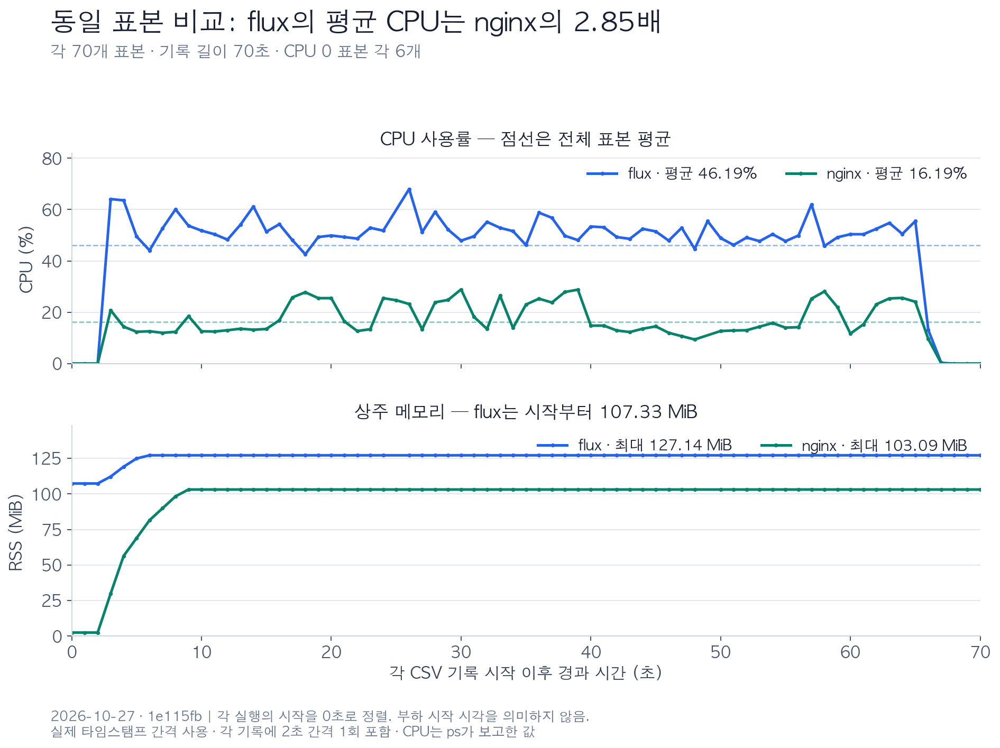
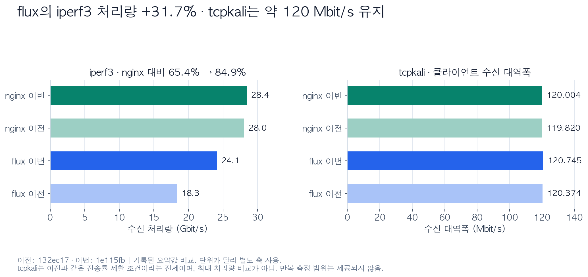

# 이벤트 처리 개선 후 벤치마크

`1e115fb` 기준으로 제공된 iperf3·tcpkali 결과를 [이전 측정](001-132ec17.md)과 비교한다. 이전 자원 수치는 당시 문서의 요약값이다. 이번 CSV는 각각 70개 표본으로 맞춘 데이터다. 이전 원본이 제공되지 않아 이전 자원 통계는 재계산하지 않았다.

이번 변경에는 백프레셔, read 직후 write 시도, 버퍼가 차거나 빌 때까지 또는 `WouldBlock`까지의 read/write 반복, 중복 이벤트 활성·비활성 호출 억제가 포함된다.

## 주요 결과

| 지표                           |      이전 flux |      이번 flux |     이번 nginx |
| ------------------------------ | -------------: | -------------: | -------------: |
| iperf3 수신 처리량             |    18.3 Gbit/s |    24.1 Gbit/s |    28.4 Gbit/s |
| nginx 대비 iperf3 처리량       |          65.4% |          84.9% |           100% |
| tcpkali 클라이언트 수신 대역폭 | 120.374 Mbit/s | 120.745 Mbit/s | 120.004 Mbit/s |
| CSV 전체 평균 CPU              |         79.47% |         46.19% |         16.19% |
| CSV 전체 중앙값 CPU            |         86.20% |         50.40% |         14.30% |
| 최대 RSS                       |      13.42 MiB |     127.14 MiB |     103.09 MiB |

**처리량 개선이 관측됐다.** flux의 iperf3 처리량은 약 31.7% 증가했다. nginx도 28.0→28.4 Gbit/s로 약 1.4% 증가했지만, flux의 nginx 대비 처리량은 65.4%→84.9%로 높아졌다. 이번에도 flux는 nginx보다 약 15.1% 낮다. 반복 측정과 변경별 분리 실험이 없어 각 최적화의 기여도와 개선율의 재현성은 아직 확인되지 않았다.

**CPU 기록은 낮아졌지만, 메모리 우위는 이번 기록에서 사라졌다.** 전체 평균 CPU는 79.47%→46.19%다. 이번 flux·nginx 기록은 표본 수·기록 길이·CPU 0 표본 수를 맞췄고, 평균 CPU는 flux가 약 2.85배다. 이전 측정까지 같은 방식으로 구간을 맞춘 것은 아니므로 이전 대비 정확한 CPU 비용 절감률은 확정하기 어렵다. 이번 flux의 최대 RSS는 nginx보다 약 23.3% 높다. flux는 기록 시작부터 107.33 MiB였으므로 이전 대비 증가분 전체를 이번 부하나 변경의 영향으로 돌릴 수 없다.

## 시각화



각 CSV의 최초 타임스탬프를 0초로 두고 실제 경과 시간으로 그렸다. 두 기록은 초반 CPU 0 표본이 3개씩이며 최초 CPU 상승은 모두 3초 시점이다. 부하 시작·종료 로그에 의한 정렬은 아니다. 표본 수와 기록 길이는 같지만 2초 간격은 flux의 24–26초, nginx의 48–50초에 있어 표본별 시각이 완전히 같지는 않다.



처리량 그래프는 문서에 기록된 요약값을 사용한다. 이전 CPU·RSS 원본이 없으므로 자원 시계열의 전후 비교는 포함하지 않았다.

## CPU·RSS 집계

| 지표                        |              flux |             nginx |
| --------------------------- | ----------------: | ----------------: |
| 기록 시각 (2026-10-27, KST) | 11:22:37–11:23:47 | 11:14:51–11:16:01 |
| 표본 수                     |                70 |                70 |
| 최초–마지막 타임스탬프 차이 |              70초 |              70초 |
| CPU가 0인 표본 수           |                 6 |                 6 |
| 전체 평균 CPU               |            46.19% |            16.19% |
| 전체 중앙값 CPU             |            50.40% |            14.30% |
| 최대 CPU                    |            68.00% |            28.90% |
| CPU > 0 표본 평균           |            50.52% |            17.71% |
| CPU > 0 표본 수             |                64 |                64 |
| 최초 RSS                    |        107.33 MiB |          2.53 MiB |
| 전체 평균 RSS               |        125.93 MiB |         96.02 MiB |
| 전체 중앙값 RSS             |        127.14 MiB |        103.09 MiB |
| 최대·마지막 RSS             |        127.14 MiB |        103.09 MiB |
| 마지막 RSS − 최초 RSS       |        +19.81 MiB |       +100.56 MiB |

평균은 시간 가중 없이 CSV 각 행을 동일 가중치로 집계했다. 두 CSV 모두 타임스탬프 간격이 2초인 곳이 한 번씩 있다. 따라서 정확히 매초 수집된 기록으로 간주하지 않는다.

### CPU 해석

동일한 70개 표본 기준 평균은 flux 46.19%, nginx 16.19%로 차이는 30.00%p, 비율은 약 2.85배다. 두 기록 모두 CPU 0 표본이 6개이므로 기존의 유휴 표본 수 차이는 해소됐다. CPU > 0인 64개 표본만 비교해도 평균은 각각 50.52%, 17.71%이며 비율은 약 2.85배다. 이 필터는 정확한 부하 구간을 보장하지 않는다.

이전 문서에서 flux는 주로 CPU 80~90%대였으며, 이번에는 CPU 0 구간 이후 대체로 45~60%대다. 이번 기록에서도 flux의 CPU 값이 더 높지만, 유사한 tcpkali 대역폭을 유지하면서 보고된 CPU 값이 낮아진 점은 개선 방향과 일치한다. 이전 원본의 동일 구간 재집계와 실제 CPU 시간 측정 없이는 정확한 절감률을 확정하기 어렵다.

### 메모리 해석

flux의 최대 RSS는 이전 13.42 MiB에서 이번 127.14 MiB로 약 9.47배가 되었다. 이번에는 시작부터 107.33 MiB이며 기록 시작 6초 후 127.14 MiB에 도달해 마지막까지 일정하다. nginx는 시작 9초 후 103.09 MiB에 도달해 일정하다. 이 기록에는 지속적인 RSS 증가가 나타나지 않지만, 짧은 구간만으로 누수 여부를 판정할 수는 없다.

현재 [connection.rs](../src/connection.rs)의 `Connection`은 방향마다 16 KiB 고정 배열 버퍼를 하나씩 가진다. 3,000개 연결이면 배열 데이터만 `3000 × 2 × 16 KiB = 93.75 MiB`다. [proxy.rs](../src/proxy.rs)는 이를 `HashMap` 값으로 보관하므로 컨테이너 여유 공간과 다른 필드의 비용도 생긴다. 이는 현재 구조의 메모리 규모를 이해하는 근거이며, 실제 RSS의 항목별 내역이나 이전 대비 증가 원인을 증명하지는 않는다.

기록 중 RSS 증가량은 flux가 작지만, 시작값이 크게 달라 메모리 효율이 더 좋다는 결론으로 이어지지는 않는다. 새 프로세스에서 부하 전·부하 중·모든 연결 종료 후 RSS와 활성 연결 수를 함께 기록하면 고정 버퍼 비용, 컨테이너 용량 유지, 이전 실행의 영향 등을 구분하는 데 도움이 된다.

## tcpkali 해석

| 클라이언트 기준 지표 |             flux |          nginx | nginx 대비 flux |
| -------------------- | ---------------: | -------------: | --------------: |
| 수신 대역폭          |   120.745 Mbit/s | 120.004 Mbit/s |          +0.62% |
| 송신 대역폭          |   120.609 Mbit/s | 119.968 Mbit/s |          +0.53% |
| 수신량 − 송신량      | +1,016,235 bytes | +269,203 bytes |               — |

약 120 Mbit/s의 대역폭은 이전과 유사하다. 이전과 같은 전송률 제한 조건이라면 최대 처리량 경쟁보다 동일 수준의 부하에서 자원 사용을 비교하는 테스트로 해석하는 것이 적절하다. 1% 미만의 대역폭 차이와 출력의 packet rate estimate만으로 성능 우위나 실제 패킷 처리 효율을 단정하기 어렵다. 수신량과 송신량의 차이도 종료 경계·집계 방식을 추가 확인해야 하며, 이 요약만으로 유실 또는 중복 전송을 판정할 수 없다.

## 원본 벤치마크 출력

```text
flux:

[SUM] 0.00-30.00 sec 84.3 GBytes 24.1 Gbits/sec 0 sender
[SUM] 0.00-30.00 sec 84.3 GBytes 24.1 Gbits/sec receiver

Destination: [127.0.0.1]:9000
Interface lo0 address [127.0.0.1]:0
Using interface lo0 to connect to [127.0.0.1]:9000
Ramped up to 3000 connections.
Total data sent: 862.7 MiB (904596710 bytes)
Total data received: 863.7 MiB (905612945 bytes)
Bandwidth per channel: 0.080⇅ Mbps (10.0 kBps)
Aggregate bandwidth: 120.745↓, 120.609↑ Mbps
Packet rate estimate: 79229.0↓, 125463.7↑ (1↓, 1↑ TCP MSS/op)
Test duration: 60.0017 s.

nginx:

[SUM] 0.00-30.00 sec 99.3 GBytes 28.4 Gbits/sec 0 sender
[SUM] 0.00-30.02 sec 99.3 GBytes 28.4 Gbits/sec receiver

Destination: [127.0.0.1]:9001
Interface lo0 address [127.0.0.1]:0
Using interface lo0 to connect to [127.0.0.1]:9001
Ramped up to 3000 connections.
Total data sent: 858.1 MiB (899796285 bytes)
Total data received: 858.4 MiB (900065488 bytes)
Bandwidth per channel: 0.080⇅ Mbps (10.0 kBps)
Aggregate bandwidth: 120.004↓, 119.968↑ Mbps
Packet rate estimate: 13194.1↓, 126156.6↑ (3↓, 1↑ TCP MSS/op)
Test duration: 60.0024 s.
```
